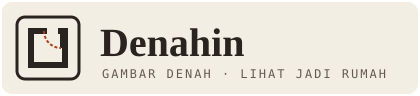
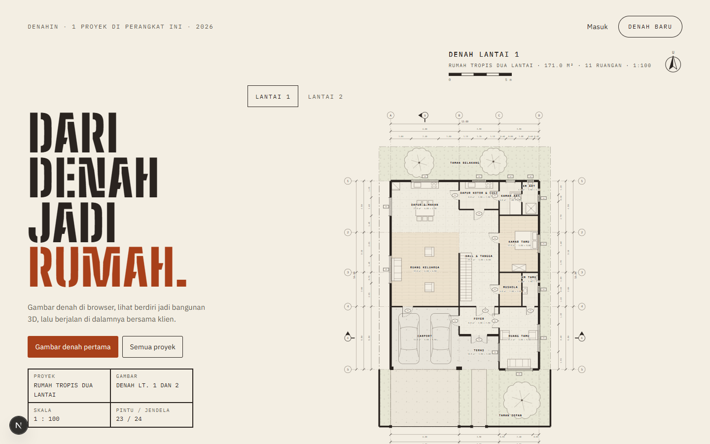
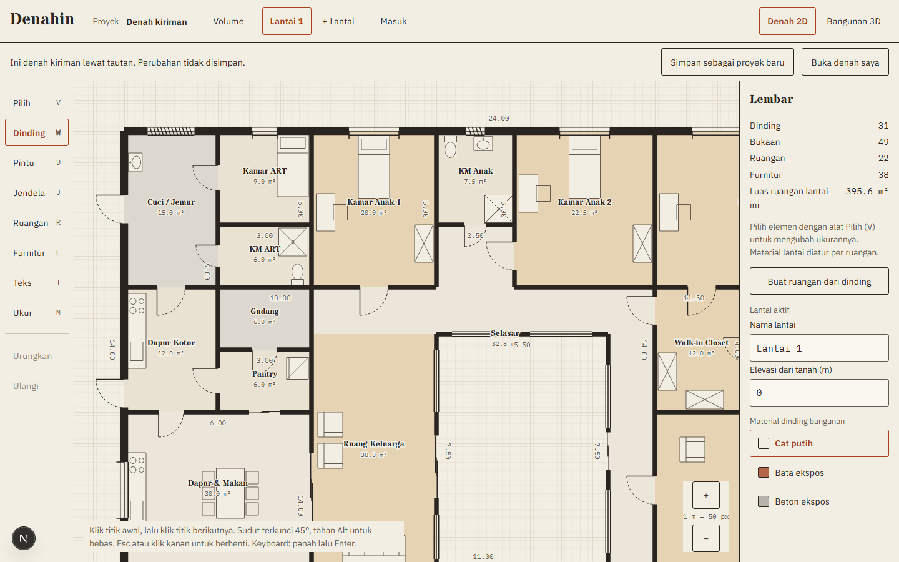
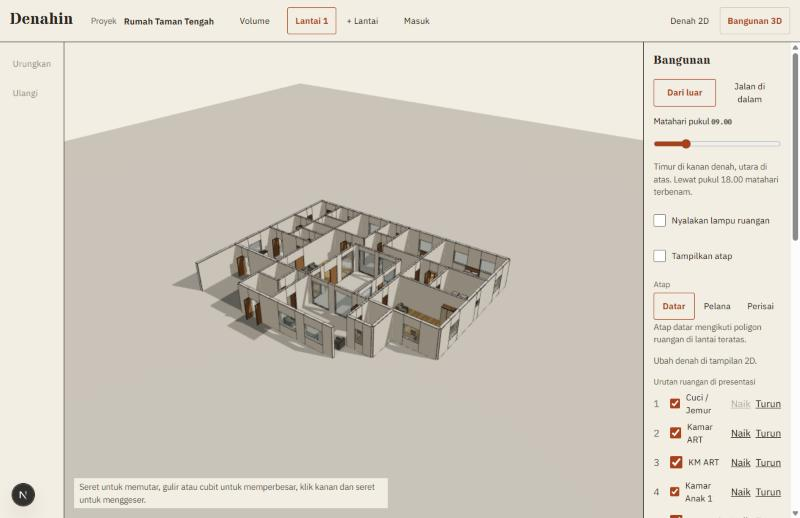
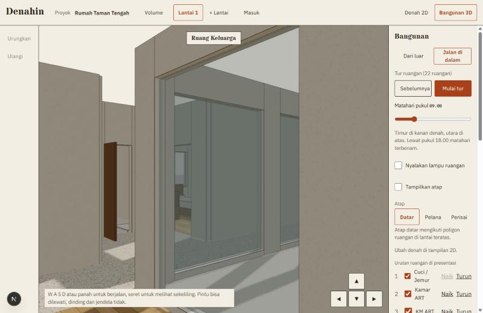
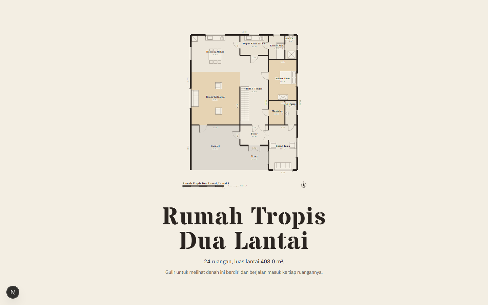
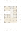
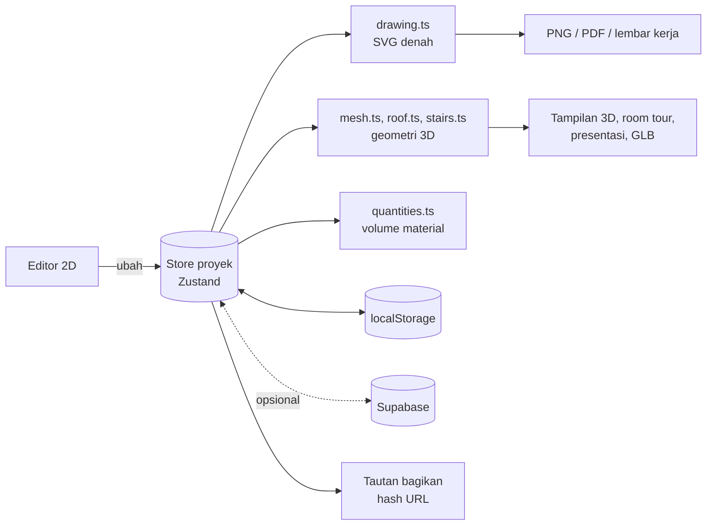

<p align="center">
  
</p>

<p align="center">
  Aplikasi web untuk arsitek: gambar denah 2D di browser, lihat bangunannya berdiri dalam 3D,<br>
  ajak klien berjalan di dalamnya, lalu kirim presentasi lewat satu tautan.
</p>

<p align="center">
  <a href="https://denahin.vercel.app"><strong>Coba langsung: denahin.vercel.app</strong></a>
</p>

<p align="center">
  
  
  
  
  
  
  
</p>

---



## Daftar isi

- [Tampilan](#tampilan)
- [Fitur](#fitur)
- [Teknologi](#teknologi)
- [Cara kerja](#cara-kerja)
- [Menjalankan](#menjalankan)
- [Akun dan cloud (opsional)](#akun-dan-cloud-opsional)
- [Struktur proyek](#struktur-proyek)
- [Pengujian](#pengujian)
- [Privasi](#privasi)
- [Lisensi](#lisensi)

## Tampilan

| Editor denah 2D | Bangunan 3D |
|---|---|
|  |  |
| **Room tour** | **Presentasi untuk klien** |
|  |  |

### Lembar gambar kerja

Gambar di halaman depan dibuat dengan kode dari data denah. Isinya: as struktur di keempat sisi, tiga lapis rantai ukuran,
kode pintu dan jendela (P1, J1), tanda potongan, arsir lantai per material, void, dan tapak (taman, pohon, carport, pintu pagar).
Lantai 1 dan Lantai 2 bisa dipilih di atas gambar.

| Lantai 1 | Lantai 2 |
|---|---|
|  |  |

Rumah contohnya adalah rumah tropis dua lantai di lahan 15 × 24,5 m, dengan luas ruang dalam 342 m², void di atas ruang keluarga, dan balkon depan.
Lantai 1 berisi zona publik dan servis, Lantai 2 zona privat. Program ruang, KDB/KLB, tangga, struktur, daftar pintu dan jendela,
serta catatan risikonya ada di [docs/rumah-contoh.md](docs/rumah-contoh.md).
Tombol "Buka contoh ini di editor" menyalinnya jadi proyek Anda sendiri.

## Fitur

**Menggambar**
- Dinding dengan snap grid, kunci sudut 45°, dan sambungan otomatis. Dinding bisa dipindah, dipecah, dan diduplikasi.
- Pintu (ayun, ganda, geser) dan jendela (buka, mati, nako) yang menempel di dinding.
- Ruangan dari klik titik atau deteksi otomatis dari dinding tertutup. Luas dihitung langsung.
- Furnitur dari katalog ukuran umum Indonesia: kasur, lemari, meja rias, sofa, meja TV, meja makan, kitchen set, kulkas, mesin cuci, kloset, bathtub, tanaman pot, pohon, mobil, kanopi bertiang, dan kolom struktur.
- Beda tinggi lantai per ruangan (misalnya KM −0,03, teras −0,05), tampil sebagai peil di denah dan di 3D.
- Tangga lurus atau tangga U dengan bordes. Tangga melubangi pelat lantai di atasnya dan bisa dinaiki saat room tour.
- Banyak lantai dengan elevasi sendiri.
- Anotasi teks dan garis ukur manual.
- Bisa dipakai penuh dengan keyboard: `[` dan `]` untuk berpindah elemen, panah untuk menggeser, Enter untuk menaruh titik.

**3D dan room tour**
- Bangunan 3D dari denah yang sama, dibuat dengan three.js tanpa file model.
- Material lantai (keramik, parket, teraso, beton) dan dinding (cat, bata ekspos, beton ekspos).
- Atap datar, pelana, perisai, atau miring satu arah (arah dan sisi tinggi bisa diatur), dengan pilihan roster di gevel, termasuk denah bentuk L dan T. Ruang lantai bawah yang tidak tertutup lantai atas otomatis diberi dak beton.
- Matahari sesuai jam (06.00 sampai 21.00) dengan bayangan, dan lampu ruangan untuk malam hari.
- Jalan di dalam bangunan dengan WASD, panah, atau tombol sentuh. Dinding tidak bisa ditembus, pintu bisa dilewati, dan tangga bisa dinaiki.
- Tur otomatis per ruangan yang urutannya bisa diatur.

**Gambar kerja**
- Lembar kerja tiap lantai: as struktur, tiga lapis rantai ukuran, kode pintu dan jendela, tanda potongan.
- Tampak empat sisi, potongan A-A dan B-B (bagian terpotong digambar hitam), dan denah atap dengan arah air dan kemiringan. Semuanya dibuat otomatis dari denah.

**Berbagi dan ekspor**
- Tautan bagikan: seluruh denah dikompres ke dalam hash URL, tanpa server.
- Presentasi scroll untuk klien: denah memudar, bangunan naik, lalu kamera masuk ke tiap ruangan.
- Ekspor PDF skala 1:100 (denah, tampak, potongan, denah atap), PNG lembar kerja, GLB untuk aplikasi 3D lain, dan file proyek JSON.
- Volume material (luas dinding per material, lantai, bukaan) dengan harga satuan isian sendiri dan perkiraan biaya material, bisa diunduh sebagai CSV untuk RAB.

**Penyimpanan**
- Proyek tersimpan di browser dan tetap jalan tanpa akun.
- Cadangan semua proyek ke satu file.
- Akun opsional (Supabase) untuk sinkron antarperangkat.

## Teknologi

| Bagian | Pilihan | Alasan |
|---|---|---|
| Kerangka | [Next.js 16](https://nextjs.org) (App Router, Turbopack) | Halaman statis cepat, rute API kecil untuk laporan kesalahan |
| UI | React 19, CSS biasa + Tailwind 4 | Gaya "kertas gambar" ditulis sendiri, tanpa pustaka komponen |
| Bahasa | TypeScript | Model denah dipakai bersama editor, 3D, dan ekspor |
| State | [Zustand](https://zustand.docs.pmnd.rs) | Satu store proyek dengan urungkan/ulangi |
| 3D | [three.js](https://threejs.org) lewat [React Three Fiber](https://r3f.docs.pmnd.rs) dan drei | Geometri dibuat dari data denah, tekstur digambar dengan kode |
| Gambar 2D | SVG yang dibangkitkan sendiri | Layar, PNG, PDF, dan lembar kerja memakai modul geometri yang sama |
| Akun dan cloud | [Supabase](https://supabase.com) (Auth + Postgres dengan RLS) | Opsional; hanya kunci publishable di browser |
| Tes | [Vitest](https://vitest.dev), Testing Library, jsdom | 127 tes untuk geometri, atap, tangga, ekspor, dan editor |
| Huruf | IBM Plex Sans/Mono, Stardos Stencil, Big Shoulders Stencil | Huruf teknik untuk angka, stensil untuk lettering gambar kerja |

## Cara kerja



Semua tampilan membaca satu model JSON proyek: dinding (titik awal, titik akhir, tebal, tinggi), bukaan, ruangan, furnitur, lantai, atap, dan anotasi.
Logika ada di `src/lib/` tanpa UI, sehingga bisa dites tanpa browser.

## Menjalankan

Butuh Node.js 22 atau lebih baru.

```bash
npm install
npm run dev
```

Buka http://localhost:3000.

| Perintah | Kegunaan |
|---|---|
| `npm run dev` | Server pengembangan |
| `npm run build` | Build produksi |
| `npm start` | Menjalankan hasil build |
| `npm test` | Tes (vitest) |
| `npm run lint` | ESLint |
| `npm run db:apply` | Terapkan `supabase/schema.sql` ke database |

### Halaman

| Alamat | Isi |
|---|---|
| `/` | Halaman depan dan daftar proyek di perangkat ini (dan di cloud kalau masuk) |
| `/proyek/[id]` | Editor. `/proyek/kiriman#denah=...` membuka denah dari tautan bagikan |
| `/presentasi#nama=...&denah=...` | Presentasi scroll untuk klien |
| `/masuk` | Masuk, daftar, lupa kata sandi |
| `/privasi`, `/syarat` | Kebijakan privasi dan syarat penggunaan |

## Akun dan cloud (opsional)

Tanpa konfigurasi ini Denahin tetap berjalan, dan proyek disimpan di browser.

1. Hubungkan proyek Vercel dan Supabase: `vercel link`, lalu `vercel integration add supabase`.
2. Tarik env: `vercel env pull .env.local --yes`.
3. Unduh sertifikat CA dari dashboard Supabase (Database Settings, SSL Configuration), lalu simpan sebagai `supabase/ca.crt`.
4. Terapkan skema: `npm run db:apply`. Tabel `projects` memakai Row Level Security per pemilik.
5. Di Supabase (Auth, URL Configuration), tambahkan alamat situs ke Redirect URLs, termasuk `/masuk/atur-sandi` untuk lupa kata sandi.

> [!WARNING]
> Hanya kunci publishable yang boleh dipakai di browser. Jangan pernah memakai service role key di kode klien.

## Struktur proyek

```
src/
  app/                 rute Next.js: halaman depan, editor, presentasi, akun, API laporan kesalahan
  components/
    dashboard/         halaman depan dan daftar proyek
    editor/            kanvas denah, alat, panel properti, dialog
    view3d/            adegan 3D, room tour, presentasi
    account/           masuk dan atur kata sandi
  lib/                 logika tanpa UI, semuanya dites
    project.ts         model data, validasi, operasi dinding dan lantai
    drawing.ts         SVG denah, lembar kerja, kode bukaan, tapak
    mesh.ts, roof.ts   geometri 3D dinding, lantai, atap
    stairs.ts, walk.ts tangga, tabrakan, dan berjalan
    exporters.ts       PNG, PDF, GLB, cadangan
    quantities.ts      volume material
    share.ts           tautan bagikan terkompresi
    sample.ts          rumah contoh halaman depan (rencana: docs/rumah-contoh.md)
docs/                  logo dan gambar README
supabase/              skema database
DESIGN.md              arah desain visual
PLAN.md                rencana dan tahap
```

## Pengujian

```bash
npm test
```

Tes mencakup geometri dinding dan bukaan, deteksi ruangan, atap L/T, tangga dan lubang pelat, tabrakan saat berjalan,
ekspor, volume material, tautan bagikan, urutan tur, laporan kesalahan, dan alur editor (komponen, jsdom).

## Privasi

- Denah tersimpan di browser pengguna. Tidak ada yang dikirim ke server tanpa akun.
- Tautan bagikan membawa denah di hash URL, yang tidak pernah dikirim browser ke server.
- Laporan kesalahan hanya berisi pesan teknis dan path halaman tanpa query dan hash, dibatasi 5 laporan per halaman.

Lihat juga halaman `/privasi` di aplikasi.

## Lisensi

[MIT](LICENSE). Bebas dipakai, diubah, dan dibagikan dengan mencantumkan pemegang hak cipta.
